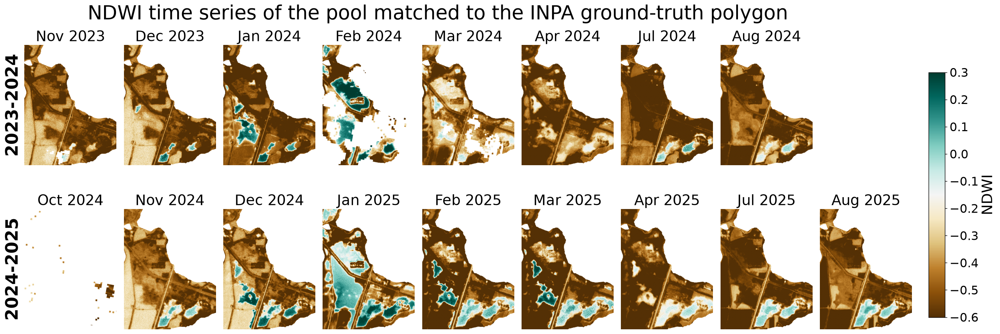

# Vernal Pool Detection Pipeline

A pipeline for detecting ephemeral winter pools (vernal pools) in Israel from
Planet satellite imagery (3 m/pixel), across 5 hydrological years (2021-2022
through 2025-2026).

## The big picture

Vernal pools are seasonal freshwater habitats that form when rainwater or
groundwater accumulates in natural or artificial topographic depressions where
the substrate limits infiltration. Their defining characteristic is
seasonality: they fill during winter and dry out completely during summer.
These typically support specialized organisms, including amphibians and
crustaceans, whose life cycles depend on a sufficient period of inundation.
Given their ecological importance and the threat of habitat loss, the Israel
Nature and Parks Authority (INPA) is working to locate and document as many
vernal pools as possible to support their conservation. Here, we present a
rule-based algorithm for identifying potential vernal pools in Israel's
Coastal Plain by integrating DEM-derived topographic depressions with
high-resolution PlanetScope time series. The algorithm identifies spatially
contiguous areas that exhibited repeated winter inundation relative to a dry
summer baseline. We apply the method across five years and compare the
detected pools with an existing INPA inventory, with the aim of identifying
additional sites for field verification and conservation.

In practice, this means:

1. Find topographic depressions in a DEM (places where water *could* pool).
2. For each depression, check its Planet NDWI (wetness index) time series
   through the winter — a depression that genuinely becomes a pool shows a
   consistent rise in wetness over its own dry summer baseline.
3. Filter out things that are definitely not a vernal pool: permanent water,
   buildings, greenhouses, industrial zones, roads, farmland (including farmland
   not tagged in OSM).
4. Merge across years — the same pool recurring across several winters is
   counted once, not once per year.

## Pipeline stages

### Stage 1 — `step1_depressions/`
Extracts depressions from a DEM using the contour-tree method (Wu et al. 2015),
an initial size/depth/shape filter, then geographic cleanup (fit to raster polygon).
Output: `output/depressions_clean.gpkg`.

### Stage 2 — `step2_planet/`
- `01_extract_ndwi.py` — for every depression, crop NDWI (Normalized Difference
  Water Index, `(Green - NIR) / (Green + NIR)`) from every relevant Planet
  scene, for every date, using only cloud-free pixels (Planet's per-scene
  usable-data mask).
- `02_score_candidates.py` — persistence scoring, per depression:
  1. Compute a dry-season baseline: the mean NDWI per pixel across that
     depression's summer dates (July-August).
  2. On each winter date, a pixel counts as wet if it rises **>=0.10** above
     its own baseline, and its absolute NDWI is above **-0.20** (a floor that
     rejects a pixel that's merely "less dry" rather than genuinely wet).
  3. To tolerate the wet boundary shifting by a pixel between dates, each
     date's wet mask is dilated by one pixel before being counted.
  4. A depression earns a pool wherever a spatially contiguous group of
     **10+** such pixels stays wet on **3+** separate winter dates (an
     elongated depression can hold more than one such component, i.e. more
     than one pool).
  Output: `output/<period>/pools_<period>.gpkg`.

### Stage 3 — `step3_osm_filter/`
Checks the detected wet core (not the raw DEM depression) against 
OSM layer (`data/osm_unified_filter_layer.gpkg`) built from both ways and
relations :
water, buildings, greenhouses, industrial/construction/quarry sites, swimming
pools, pre-buffered roads/waterways, and broad landuse zones
(residential/commercial/retail/port/military/wastewater).

### Stage 3b — `step3b_worldcover_filter/`
Two more sources, independent of OSM (to catch what OSM misses — farmland and
greenhouse tagging in Israel is very incomplete):
- **ESA WorldCover** (10 m, 2021): filters cropland and built-up land.
- **Global-PCG-10** (Niu et al. 2025): a purpose-built global map of plastic-
  covered greenhouses, 10 m. Only the tiles covering our area were downloaded
  (not the full global archive).

### Stage 4 — `step4_cross_year/`
Merges pools across years: two candidates (from any period, including the
same one) are the same pool if their geometries, each buffered by **6 m**,
intersect. Grouped transitively (union-find). `n_periods` counts unique years,
not raw member count (a pool can split into two components in the same year;
flagged with a `*`).

Ground-truth (GT) check: a GT polygon is only tested if its centroid falls
inside Planet's actual coverage area. Overlap is tested with a **4 m** buffer
around each polygon (both the detected pool and the GT polygon).

## Results (as of 2026-10-19)

### Filtering funnel

| Stage | Candidates remaining |
|---|---|
| Stage 1 — DEM depressions | 171,575 |
| Stage 2 — persistence scoring (summed across 5 years) | 107,346 |
| Stage 3 — OSM filter | 8,719 |
| Stage 3b — WorldCover / Global-PCG-10 filter | 3,474 |
| Stage 4 — merged across years | **1,965** |

Stage 1's count is a single, period-independent layer; stages 2-3b are summed
over all 5 years' per-period outputs (so the same real-world depression is
counted once per year it was re-detected in), which is why the funnel isn't a
simple year-by-year subset.

### Per year

| Year | Pools detected | GT overlap |
|---|---|---|
| 2021-2022 | 659 | 12/109 (11.0%) |
| 2022-2023 | 564 | 9/109 (8.3%) |
| 2023-2024 | 668 | 6/109 (5.5%) |
| 2024-2025 | 767 | 7/109 (6.4%) |
| 2025-2026 | 816 | 6/109 (5.5%) |

**Merged across all 5 years:** 1,965 pools, GT overlap: **19/109 (17.4%)** —
significantly more than any single year, since each winter reveals a
different subset of pools (depending on that year's rainfall).

### Recurrence

How many of the 1,965 merged pools were detected in exactly how many of the 5
years:

| Years detected | Pools |
|---|---|
| 1 | 1,470 |
| 2 | 301 |
| 3 | 115 |
| 4 | 51 |
| 5 | 28 |

### Visual examples

